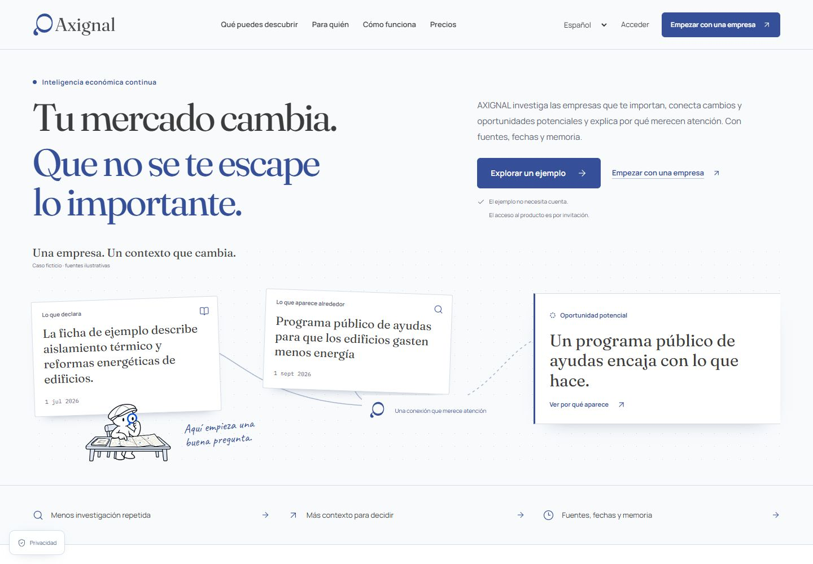

# AXIGNAL · entrega visual para revisión

**La nueva experiencia está aislada. La aceptación visual, narrativa e interactiva corresponde al CTO.**

[Abrir landing-app local](http://127.0.0.1:3822/es/landing-lab) · [Galería navegable local](http://127.0.0.1:3823/) · [Pruebas y siete omisiones](verification.md) · [Lighthouse](performance.md) · [Revisión de los PR fusionados](review-merged-prs.md)

## Comparaciones completas

| Perfil | Landing anterior | Nueva landing-app |
| --- | --- | --- |
| Escritorio, 1440 × 1000 nominal | [Captura completa](evidence/old-desktop-full.jpg) | [Captura completa](evidence/new-desktop-full.jpg) |
| Móvil, 390 × 844 nominal | [Captura completa](evidence/old-mobile-full.jpg) | [Captura completa](evidence/new-mobile-full.jpg) |

Las imágenes completas conservan toda la página y se pueden abrir a tamaño original. Son capturas reales del navegador, no composiciones ni referencias del briefing. El manifiesto registra dimensiones efectivas, hashes y fechas. La referencia visual 197f9ee y el código final sólo difieren en metadatos sociales y su verificación HTTP; el código pintado y sus fixtures son idénticos.

## Estados y recorrido

| Estado | Evidencia |
| --- | --- |
| Descubrimiento · demanda potencial | [Abrir captura](evidence/discovery-desktop.jpg) |
| Hallazgo · razón y límites | [Abrir captura](evidence/finding-reason-desktop.jpg) |
| Conexiones · declaración pública, no contrato verificado | [Abrir captura](evidence/connections-desktop.jpg) |
| Evidencia · extractos, fechas y condiciones desconocidas | [Abrir captura](evidence/evidence-desktop.jpg) |
| Julio · señal aún no observada | [Abrir captura](evidence/temporal-july-desktop.jpg) |
| Septiembre · aparece una oportunidad potencial | [Abrir captura](evidence/temporal-september-desktop.jpg) |
| Octubre · actividad publicada observada | [Abrir captura](evidence/temporal-october-desktop.jpg) |
| Observación digital · instrumento y dos muestras | [Abrir captura](evidence/digital-evidence-desktop.jpg) |
| Reputación · desconocido no es negativo | [Abrir captura](evidence/unknown-desktop.jpg) |
| Perfil profesional · desarrollo de negocio | [Abrir captura](evidence/professional-workflow-desktop.jpg) |
| Precio · 25 organizaciones y asesoría separada | [Abrir captura](evidence/pricing-desktop.jpg) |
| El Observador · recorrido de las tres poses originales | [Abrir captura](evidence/observer-journey-desktop.jpg) |
| Movimiento reducido · timelines retirados | [Abrir captura](evidence/reduced-motion-desktop.jpg) |
| Evidencia abierta en móvil · página completa | [Abrir captura](evidence/evidence-mobile-full.jpg) |
| Observatorio actual · AXENT por familia | [Abrir captura](evidence/observatory-axent-mobile.jpg) |
| Guía MCP actual · ejemplo sin autorización de conexión | [Abrir captura](evidence/mcp-guide-mobile-full.jpg) |

## Cómo recorrer la demostración

1. Abre la landing local y empieza a desplazarte o pulsa «Explorar un ejemplo». GSAP acompaña la conexión de indicios con una posibilidad, sin obligarte a terminar una secuencia.
2. Cambia entre demanda, SEO/GEO, relaciones, cambios y límites. Abre la razón y las fuentes. Recorre julio, septiembre y octubre: no aparece antes lo que aún no se había observado.
3. Cambia el perfil profesional y calcula el precio para 1, 5, 25 o 100 organizaciones. El acceso actual se explica como invitación Design Partner.
4. Entra en el Observatorio para otros casos ficticios, prueba AXENT por familia y abre la guía de tu propio agente. La demo declara sus límites y no ejecuta investigación real.
5. Prueba el menú móvil, Escape y el control «Reducir movimiento» del footer. Los CTA, enlaces y disclosures siguen disponibles.

El standalone local no incorpora el backend público de adquisición/OAuth: las páginas de acceso y contacto muestran su indisponibilidad real, sin registrar solicitudes. La revisión no incluye un alta, un cobro ni una primera observación de producción.

[Manifiesto de capturas](evidence/captures.json) · [Matriz de 18 casos responsive/i18n](evidence/browser-matrix.json) · [HTML/SEO servido](evidence/ssr-check.json)

Estado: **IMPLEMENTADO + PROBADO + VISUAL_EVIDENCE_READY + HUMAN_VISUAL_ACCEPTANCE_PENDING**.
