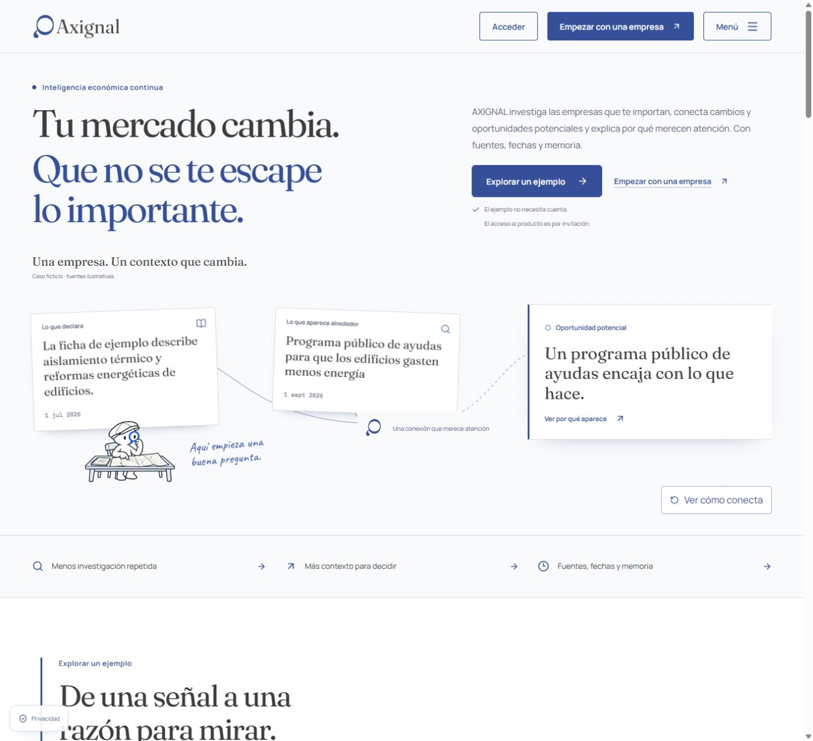
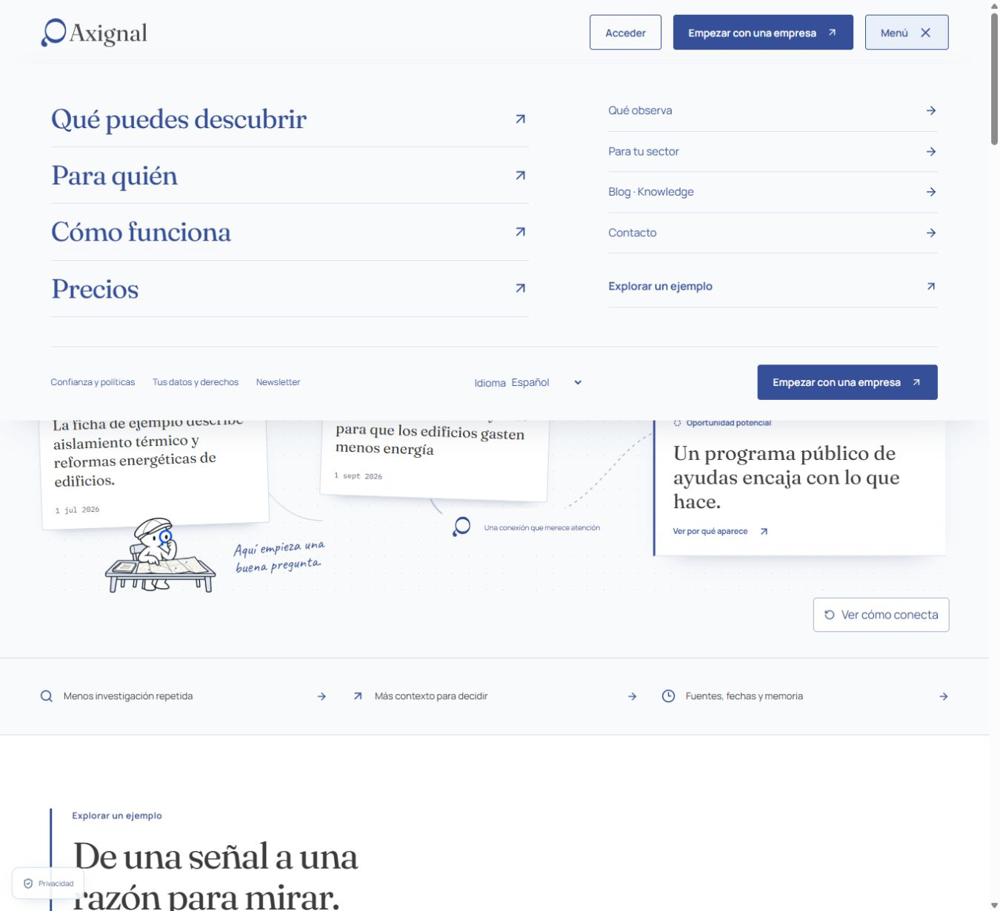
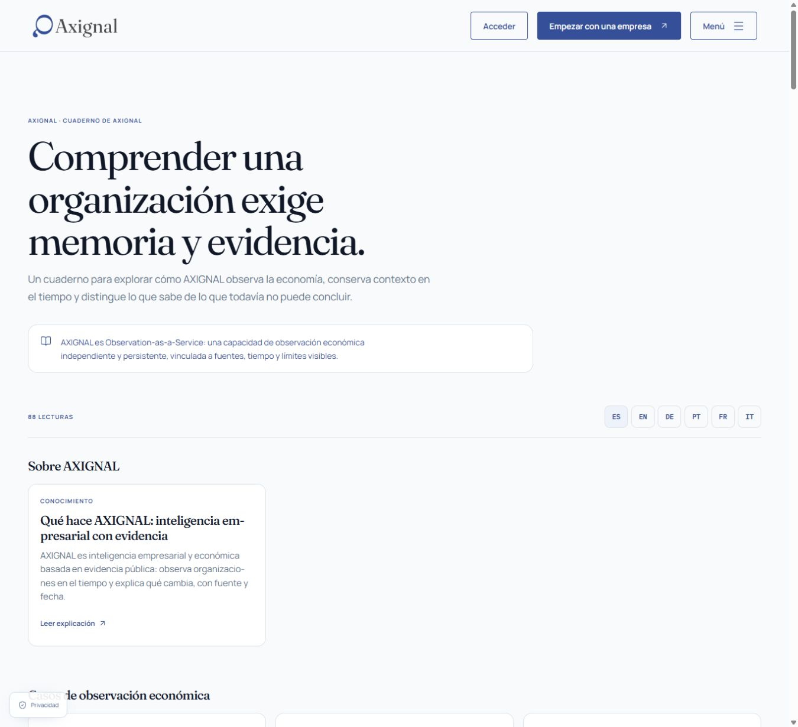
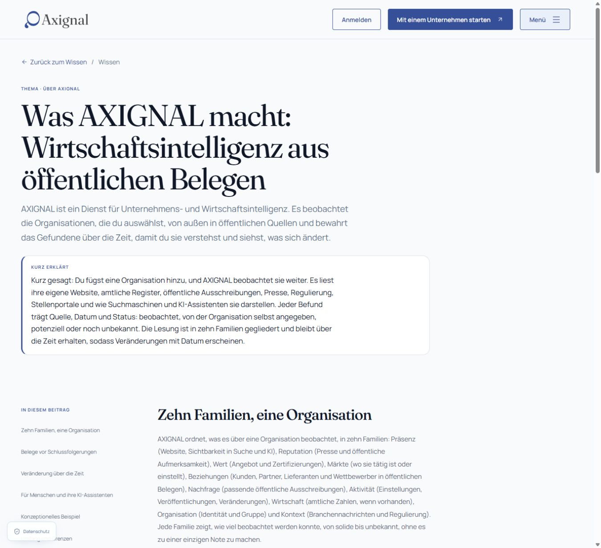
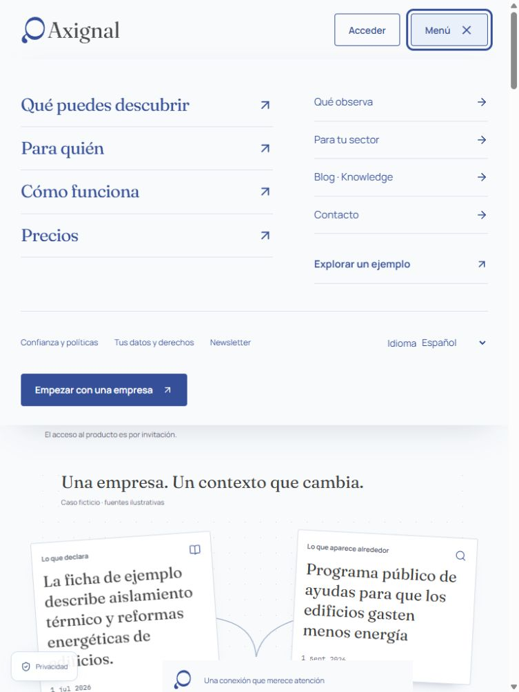
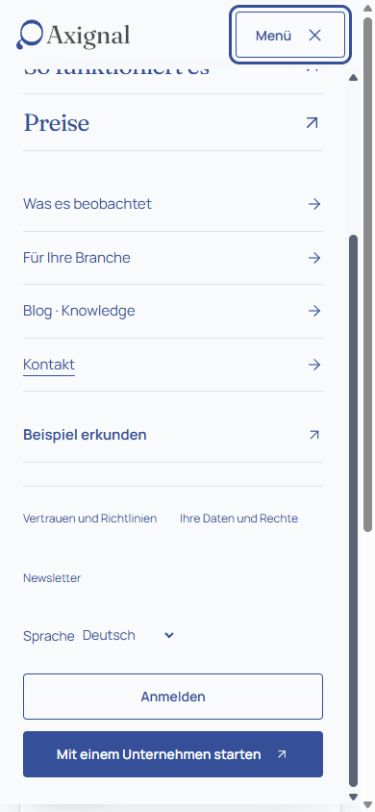
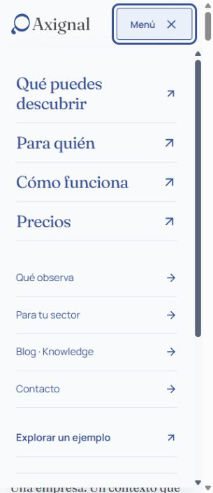

# Global header — rendered evidence

Captured 2026-10-21 in the Codex in-app browser against the local production build at `http://127.0.0.1:3830`, application revision `dc5514ab019baee8a9f5bc494e61f07d77fe6a84`. The owner explicitly authorized this origin after browser auto-review requested explicit access permission. No security bypass or alternate browser automation was used.

These are original browser JPEG screenshots, not generated mockups or accepted Golden Masters. [manifest.json](manifest.json) records route, state, CSS viewport, actual image dimensions and SHA256. Browser screenshot dimensions differ from the CSS viewport and are recorded separately; no image was resized. Viewport overrides and the temporary app movement-reduction preference were restored after QA.

## Desktop: one bar, full navigation

## Same header on other page families

## Tablet and phone

## Verification scope

Enter/Space, Tab progression and exit, Escape/focus return, outside dismissal, panel scrolling, Back/Forward, representative landing/catalog/blog/article/contact/access journeys and language continuity were exercised. The six-language 320px geometry observations are in [language320-checks.json](language320-checks.json); they are not six complete visual reviews.

See [validation](../validation.md) for the full evidence and limits. Contact backend delivery, authentication, OS-level reduced-motion emulation, new Lighthouse scores and real INP were not established by these screenshots. Human visual acceptance remains pending; no merge or production deployment was performed.
